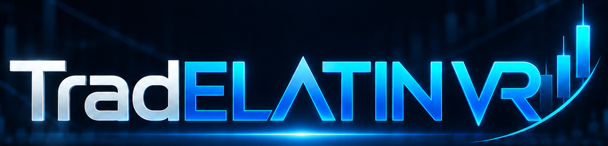

# TradElatin VR1 Press Kit

## Company Description
TradElatin VR1 is an emerging technology initiative focused on AI-enabled market intelligence. The project develops modular tools for financial data interpretation, combining real-time analytics, statistical processing, and human-centered visualization.

## Founder Biography
**Ottmar Uriza** is the founder of TradElatin VR1 and ELATIN. He has an engineering background in algorithms and mechatronics research, with a focus on applying advanced computational methods to complex systems analysis.

## Product Summary
TradElatin VR1 is a structured platform that processes market data through staged pipelines, mathematical transformations, and classification layers before exposing results through contracts, dashboards, and AI-driven analysis modules.

## Key Differentiators
- Architecture-first design with clear processing stages.
- Combination of signal processing, machine learning, and market structure analytics.
- Support for both simulated and live data integration paths.
- Focus on transparency and extensibility for technical collaborators.

## Technology Overview
The platform stack includes Python, FastAPI, React, Docker, REST APIs, JSON contracts, machine learning workflows, and high-performance analytics methods for time series and signal-oriented processing.

## Contact
Official contact channels will be published soon.

## Official TradELATIN VR Logo
The official TradELATIN VR logo is available at: `assets/logo/tradelatin-vr-logo.png`

## Official Profile
- GitHub: https://github.com/DrUriza

## VR roles and authority

- VR1 — OBSERVE
- VR2 — STRUCTURE
- VR3 — PREDICT
- VR4 — DECIDE & EXECUTE
- VR5 — INTELLIGENCE & ORCHESTRATION — In development

The functional pipeline is VR1 → VR2 → VR3 → VR4. VR5 coordinates transversally across these layers; its agent, tool and workflow capabilities are architectural targets. **LLM ≠ Trading Authority**: execution authority remains in VR4.
